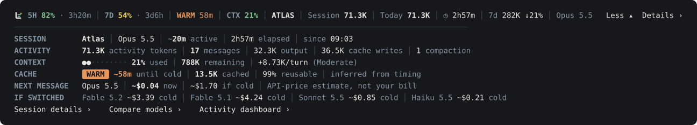
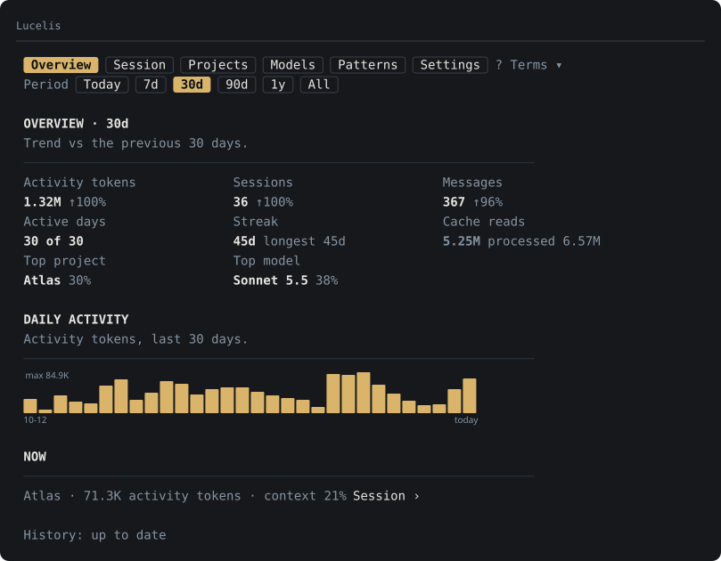
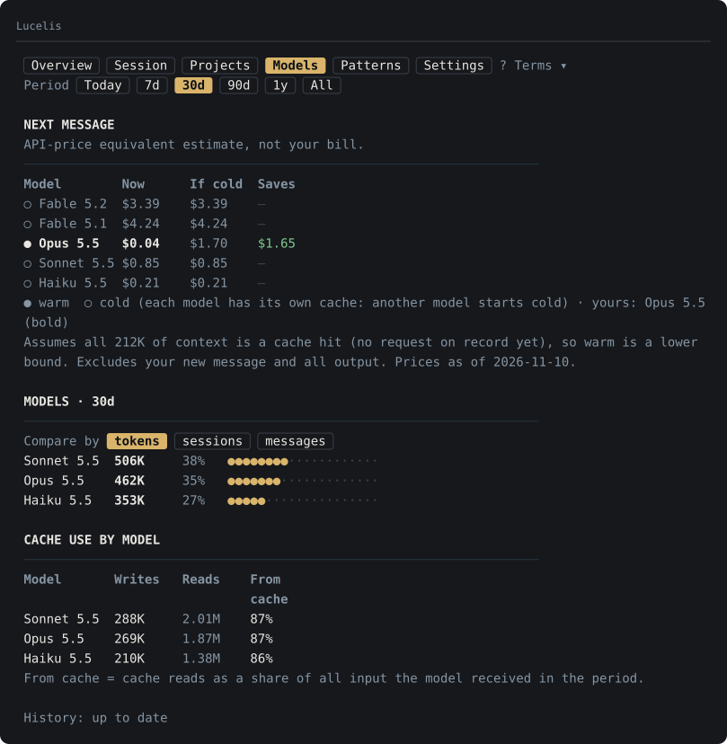

# Lucelis for Claude Code

A lightweight usage bar and local activity dashboard for Claude Code on Windows.

Lucelis shows your 5-hour and 7-day quota, prompt-cache state, context usage, current-session activity, next-message cost estimates, and historical project/model analytics directly inside Claude Code.

Everything is processed locally. No telemetry, no analytics server, and no transcript data leaves your machine. The one network request is the optional Check for updates button.

Lucelis is an independent community plugin and is not affiliated with Anthropic.

**Local-only • No telemetry • No model calls • Network only when you press Check for updates**


*The pictures on this page are drawn from the plugin's own output using made-up sample data (project "Atlas"). They show the content and layout; the desktop app draws it with its own fonts, buttons and theme.*

## What it does

Lucelis has three levels. Each one opens the next.

### 1. The bar (always visible, above the prompt)

| On the bar | Meaning |
|---|---|
| `5H 59% · 3h40m` | 5-hour quota **left**, and time until it resets. |
| `7D 13% · 4d5h` | 7-day quota **left**, and time until it resets. |
| `WARM 58m` / `COLD` | Prompt-cache state for this conversation and minutes until it goes cold. Inferred, see below. |
| `CTX 44%` | Context window **used** by this conversation. |
| `ATLAS` | Current project. |
| `Session 1.95M` | Activity tokens of this session so far. |
| `Today 923K` | Activity tokens of this project since local midnight. |
| `◷ 18h27m` | Time since the session started. |
| `7d 15.2M ↑12%` | All projects, last 7 days, against the 7 days before. |
| `Fable 5.2` | Current model. |

- **Health colours.** The 5H and 7D figures are green with 70% or more left, red at or under your low level (30% by default, set in Settings), and yellow between. Context is green from 70% left, yellow from 30%, red below.
- **The Lucelis mark** leads the bar in the desktop app. Its two bars draw in while Claude is working on a reply and it is still otherwise. Its glint turns red while a quota is at or under your warning level.
- **Low-quota warning.** When what is left of the 5-hour or 7-day quota drops to your level (30% by default), its figure on the bar and the logo glint turn red, and Lucelis tells you once for that quota window: a short pop-up in the app, and a Windows notification if you turn that on. With several sessions open, only one of them warns.
- **One or two lines.** On a wide window everything sits on one row; on a narrow one, items that do not fit move to a second row.
- **Your choice of items.** Every item has its own switch, and Settings tells you why an item is not showing (off, no room, no data yet).

### 2. More ▾ (a summary of the current session)



Six short lines: SESSION, ACTIVITY, CONTEXT, CACHE, NEXT MESSAGE and IF SWITCHED.

- **NEXT MESSAGE** estimates what your next message would cost now, and what it would cost if the cache had gone cold.
- **IF SWITCHED** shows the same prompt on the other models, with **Compare models ›** for the full table.

### 3. Details › (the Activity Dashboard)





A pane beside the chat, built from your own local history:

| Tab | Shows |
|---|---|
| Overview | Activity tokens, sessions and messages for the period, trend against the previous period, top project and model, this week against the same days of last week, daily activity. |
| Session | The current session in full: tokens by kind, context, cache state and reuse, this project today. |
| Projects | Every project with its share, sessions, messages and trend; open one for its own breakdown. |
| Models | Next-message cost comparison across models, then usage per model. |
| Patterns | Activity heatmap, peak hours and weekdays, time-of-day split. |
| Settings | Everything below, plus cache status, a manual refresh, CSV export and Check for updates. |

**? Terms** in the pane explains every figure. Periods: today, 7 days, 30 days, 90 days, 1 year, all.

## Compatibility

Supported:
- Windows 10/11
- Claude Code 2.1.317 or newer with mod/plugin support

Tested release environment:
- Claude Desktop 4.23118.1.0
- Claude Code 2.1.321

macOS and Linux are not currently supported because the history extractor uses Windows PowerShell 5.1.

There are no other dependencies: no server, helper app or background service.

## Install

### From GitHub (one step)

Type this in a Claude Code session:

```
/plugin install lucelis --marketplace obiwong2579/Lucelis
```

Then start a new Claude Code / Desktop Code session.

### From a downloaded folder

1. Extract Lucelis somewhere permanent.
2. Run:

   ```bash
   claude plugin marketplace add "C:\path\to\Lucelis"
   ```

3. Run:

   ```bash
   claude plugin install lucelis
   ```

4. Start a new Claude Code / Desktop Code session.

The bar appears after the first reply. The first start reads your whole history once (a few seconds); after that only new lines are read. More detail is in [INSTALL.md](INSTALL.md).

## Commands

| Command | Does |
|---|---|
| `/lucelis` | Open the Activity Dashboard. |
| `/lucelis-settings` | Open Settings. |
| `/lucelis-refresh` | Read new history now. |
| `/lucelis-rebuild` | Rebuild the cache from all transcripts. |

## Turn it on and off

| To | Do |
|---|---|
| Hide the bar but keep the plugin loaded | Settings tab, **Show bar: Off** (or `/lucelis-settings`) |
| Disable the plugin | `claude plugin disable lucelis@lucelis` |
| Enable it again | `claude plugin enable lucelis@lucelis` |
| See its state | `claude plugin list` |

Disabling stops every hook, the once-a-minute redraw and all history reads. It takes effect in sessions started afterwards (or after `/reload-plugins` in a terminal session). Your settings and the history cache are kept.

Only one plugin can draw the row above the prompt. If you also run another one that does, the plugin that comes first in your plugin list wins, which is normally the one installed first, and Lucelis stays loaded but invisible. Disable the other plugin to see Lucelis: `claude plugin disable <plugin>@<marketplace>`.

## Configure

`/lucelis-settings`, or Details then the Settings tab.

- **Show bar.** Turns the whole bar on or off.
- **Display mode.** Minimal: the two quotas. Normal: one row with everything that fits. Detailed: always two rows.
- **Wrap to a second row.** In Normal mode, items that do not fit the first row move to a second one. On a wide window the bar stays one row.
- **Lucelis logo.** The logo at the start of the bar. On by default.
- **Low-quota warning.** On by default. Low level for 5H and 7D (10, 20, 30 or 40% left; 30% by default): at or under it the figure and the logo glint are red. The warning on/off governs only the in-app pop-up (on), a Windows notification (off), and with notifications on, a "quota is back" notification booked for the reset time (off).
- **Bar background.** Off by default: the bar uses the app's own background and text colour, in light and dark themes. On puts a navy fill behind the bar items.
- **Compact bar items.** One toggle per item, listed in priority order. Each shows its state: shown, off, hidden by Minimal, no room at this width, or no data yet.
- **Dashboard.** Default period and heatmap metric.
- **Project aliases.** `C:\path\to\folder => Name` maps a folder and everything under it to one project. An alias named like an existing project joins it.
- **Export.** **Export CSV** saves one row per day, project and model (token counts, responses, sessions; no conversation text) for the period shown, to your Documents folder or a folder you set. It opens in Excel.
- **Updates.** **Check for updates** asks GitHub for the latest version number, only when you press it. If a newer one is out, **Copy update commands** puts the two update commands on your clipboard to paste into the prompt; Lucelis never installs anything itself.

A good everyday setup: Normal, Wrap to a second row on, and 5H, 7D, Cache, Context and Reset times on. Add the rest to taste.

## What the numbers mean

- **Activity tokens** = uncached input + cache writes + output. Cache reads are not included.
- **Cache reads** = previously cached context processed again on each request. Shown separately.
- **Processed tokens** = activity tokens + cache reads.
- **Output tokens** on a session are the total for the whole session, not the last reply.
- **Messages** = your prompts + the main thread's responses.
- **5H / 7D and reset times** come from Claude Code itself and are never estimated. None of the token totals is your subscription usage.
- **WARM / COLD is inferred**, not reported by Claude: a model's cache is taken as warm for 60 minutes after that model's last request in this session. Each model has its own clock.
- **Project** = an alias you set, else the enclosing git repository, else the first folder under the directory your sessions start in.

### Cost estimates

Next-message costs are API-price-equivalent estimates, not charges to your Claude subscription. They estimate prompt-side cost and do not represent your actual bill.

They cover the input side only and exclude your new message and all output. Prices are a dated table in `hooks/prices.ts`, matched on exact model ids; a model that is not in the table is shown as unpriced, never guessed.

## Privacy

**Local-only • No telemetry • No model calls • Network only when you press Check for updates**

Lucelis calls no model and has no telemetry. It makes no network request on its own. The one exception is the **Check for updates** button in Settings: only when you press it, Lucelis downloads the public file `https://raw.githubusercontent.com/obiwong2579/Lucelis/main/.claude-plugin/plugin.json` to read the latest version number. Nothing about you or your usage is sent.

| It reads | Why |
|---|---|
| `~/.claude/projects/**/*.jsonl` (read-only) | Token counts, timestamps, model ids, working folders and session titles from your transcripts. Message text is never kept. |
| Whether a `.git` folder exists above a working folder | To name projects. |
| Quota, context and model of the live session | From Claude Code's plugin API. |

| It writes | What |
|---|---|
| `~/.claude/lucelis/cache-a.json`, `cache-b.json` | Aggregated counts per day, model and folder, plus per-session totals. |
| Its plugin settings (Claude Code's plugin store) | Your bar settings and aliases. |
| `~/.claude/lucelis/warned.json` | Which quota windows were already warned about, so several sessions warn only once. Cleared as windows reset. |
| `Lucelis-export-<date>.csv`, only when you press Export CSV | In your Documents folder, or the folder you set. |

It never modifies a transcript. To remove everything it stored, delete `~/.claude/lucelis/`.

## Resource use

- Idle: one redraw a minute to move the countdowns. It reads no files and starts no process.
- History is read only at session start, after a reply (at most once a minute), when the pane opens (at most once a minute) and on the two commands. Each read starts one short-lived `powershell.exe` that reads only the bytes added since the last read (about half a second).
- A full rebuild of roughly 640 MB of transcripts takes about 4.5 seconds and peaks near 190 MB in that short-lived process.

## Update

- **Installed from GitHub:** Settings → **Check for updates**, or type `/plugin marketplace update lucelis` and then `/plugin update lucelis@lucelis` into the prompt; then start a new session.
- **Installed from a folder:** replace the folder's files with the new version and start a new session (or run `/reload-plugins`). Claude Code reads a folder marketplace in place.

Settings and the cache carry over. A new parser version rebuilds the cache by itself.

## Uninstall

```bash
claude plugin uninstall lucelis@lucelis
```

```bash
claude plugin marketplace remove lucelis
```

Then delete `~/.claude/lucelis/` if you want the cache gone too.

## Troubleshooting

| Symptom | Try |
|---|---|
| No bar | It appears after the first reply. Check `claude plugin list` shows it enabled, and that Show bar is On (`/lucelis-settings`). |
| Another usage bar shows instead | That plugin comes first in the list and holds the row. Disable it; Lucelis then draws. |
| Bar shows quotas but the dashboard says "No history yet" | Run `/lucelis-refresh` and read the result line in Settings, Data. `powershell.exe` must be allowed to run. |
| Figures look wrong after moving or renaming folders | `/lucelis-rebuild`. |
| An item is on but not on the bar | Settings shows why: no room at this width, Minimal mode, or no data yet. Turn on Wrap to a second row, or close the pane (it narrows the bar). |
| Your model shows "no price on record" | Its id is not in `hooks/prices.ts` yet. Nothing is estimated for it. |
| Fewer items right after a restart | Claude has not reported 5H / 7D yet. They return after the next reply. |

## Known limitations

- Windows only.
- The chat column holds roughly 80 to 90 characters on any monitor, so one row cannot show every item. Use Wrap to a second row or Detailed.
- At most two rows. On a very narrow window the lowest-priority items are left out, and Settings names them.
- The cache state and the cost figures are estimates, as described above.
- Custom titles and history are read from Claude Code's transcript format; a future format change may need an update.

## Development

```bash
claude plugin validate .
```

```bash
claude plugin test .
```

The suite has 61 tests and runs on made-up data only. Whole-history checks (totals against a separate count, duplicate copies, corrupt rows, project detection) run on a synthetic history in `tests/fixtures/synthetic-history.ts`.

Two more tests compare against a ground-truth fixture generated from a machine's own transcripts (`tests/fixtures/real-history.ts`). That fixture is private and not included. Without it those two are not run: the output lists them as `(skip)` and they are not counted as passed.

## License

Copyright (c) 2026 obiwong2579. Lucelis is licensed under the [PolyForm Noncommercial License 1.0.0](https://polyformproject.org/licenses/noncommercial/1.0.0): you may use, copy, change and share it for any noncommercial purpose. Commercial use, including selling it or offering it as part of a paid product or service, is not permitted without the copyright holder's written permission. See `LICENSE`. Changes are listed in [CHANGELOG.md](CHANGELOG.md).

Lucelis is an independent project and is not affiliated with Anthropic.
